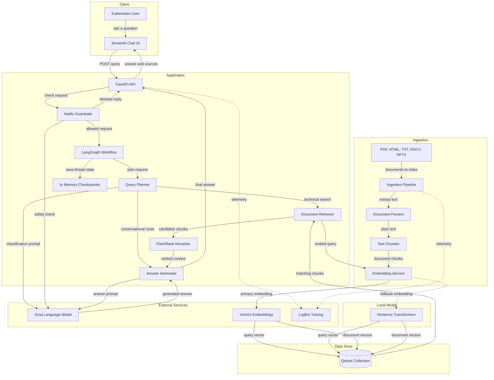
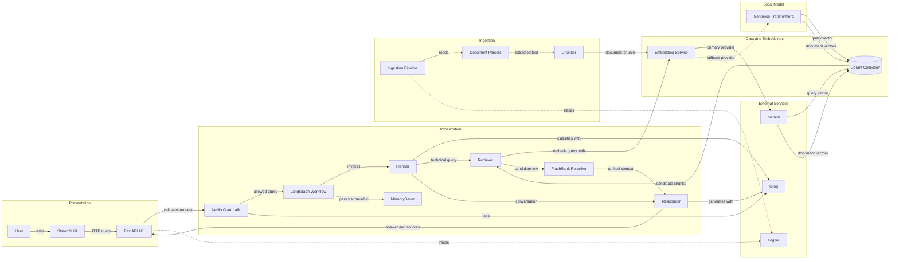

# Architecture Diagram

KubePilot is a document-question-answering application with a Streamlit client, a FastAPI and LangGraph backend, and a document ingestion pipeline. It uses Groq for language-model tasks, Qdrant for vector storage, and Gemini embeddings with a local fallback.

## Application Architecture

<!-- mermaid-checked: no \n, no em-dash/en-dash, no {} in labels, subgraphs are id["label"], arrows are -->|"label"|, all subgraphs closed by end, ids unique -->

### Technology Stack Summary

| Layer | Technology | Version | Purpose |
| --- | --- | --- | --- |
| Presentation | Streamlit | Not pinned | Chat interface and source display |
| API | FastAPI and Uvicorn | Not pinned | HTTP endpoints for queries and graph |
| Orchestration | LangGraph | Not pinned | Conditional planner, retrieval, and response flow |
| Guardrails | NeMo Guardrails | Not pinned | Checks requests before retrieval |
| Language model | Groq | `GROQ_MODEL`, default `openai/gpt-oss-120b` | Planning, guardrails, and answer generation |
| Embeddings | Gemini embedding model | `gemini-embedding-2-preview` | Primary document and query vectors |
| Embeddings fallback | Sentence Transformers | `all-mpnet-base-v2` | Local 768-dimension fallback |
| Vector storage | Qdrant | Endpoint configured by environment | Stores and searches document vectors |
| Reranking | FlashRank | Not pinned | Locally reranks candidate chunks |
| Observability | Logfire | Not pinned | Application and ingestion tracing |
| Document parsing | pypdf, BeautifulSoup, python-docx, python-pptx | Not pinned | Extracts supported document formats |

Dependency versions are not pinned in `requirements.txt` unless a minimum is specified.

### Data Storage and External Services

Qdrant stores document vectors and payloads in the `enterprise_rag` collection. The ingestion pipeline also writes parsed chunk metadata as JSON under local `processed_data/`. LangGraph uses an in-memory checkpointer, so conversation state is not durable across backend restarts. Groq handles model requests; Gemini provides embeddings, with a local Sentence Transformers fallback. Logfire captures traces when configured.

### Key Architectural Decisions

- A conditional LangGraph workflow skips document retrieval for conversational turns and retrieves context for technical questions.
- FlashRank reranks Qdrant candidates locally before answer generation.
- The Qdrant collection's vector dimension is checked against the selected embedding model to avoid incompatible vectors.
- Conversation state is held in memory; persistent conversation storage is not configured.

## Component Relationships

<!-- mermaid-checked: no \n, no em-dash/en-dash, no {} in labels, subgraphs are id["label"], arrows are -->|"label"|, all subgraphs closed by end, ids unique -->

### Component Inventory

| Component | Layer | Type | Responsibility |
| --- | --- | --- | --- |
| Streamlit UI | Presentation | Web client | Sends chat requests and displays answers and sources |
| FastAPI API | Presentation | HTTP API | Exposes health, graph, and query endpoints |
| NeMo Guardrails | Orchestration | Request policy | Allows or blocks a user query before retrieval |
| LangGraph Workflow | Orchestration | State graph | Routes requests through planning, retrieval, and response |
| Planner | Orchestration | Agent node | Chooses conversational handling or technical search |
| Retriever | Orchestration | Agent node | Embeds a query and fetches candidate chunks from Qdrant |
| FlashRank Reranker | Orchestration | Ranking service | Orders candidate chunks by semantic relevance |
| Responder | Orchestration | Agent node | Produces the final answer using history and retrieved context |
| MemorySaver | Orchestration | In-memory checkpointer | Retains thread state during the backend process lifetime |
| Ingestion Pipeline | Ingestion | CLI workflow | Processes files and indexes their chunks |
| Document Parsers | Ingestion | File loaders | Extracts text from supported file formats |
| Chunker | Ingestion | Text processor | Splits extracted text into searchable chunks |
| Embedding Service | Data and embeddings | Model adapter | Uses Gemini or the local fallback to create vectors |
| Qdrant Collection | Data and embeddings | Vector store | Stores and searches chunk vectors and payloads |
| Groq | External service | LLM provider | Supports planning, guardrails, and answer generation |
| Gemini | External service | Embedding provider | Creates primary document and query vectors |
| Sentence Transformers | Local model | Embedding model | Provides fallback vectors when Gemini is unavailable |
| Logfire | External service | Observability | Receives application and ingestion traces |
