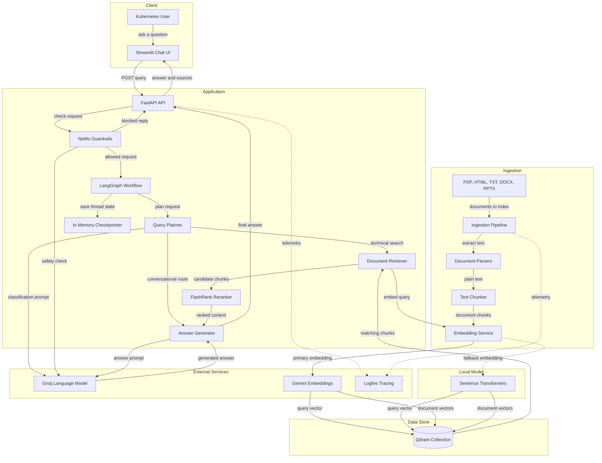

# KubePilot

> **AI-powered answers from your Kubernetes and technical documentation**

KubePilot is a retrieval-augmented generation (RAG) application. Add documents to the ingestion pipeline, index them in Qdrant, and ask questions through a Streamlit chat UI.

| Chat UI | API | Agent workflow | Vector search |
| --- | --- | --- | --- |
| Streamlit | FastAPI | LangGraph | Qdrant |

## Architecture

The request flow checks user questions with NeMo Guardrails, then routes them through a LangGraph workflow. Technical questions retrieve and rerank relevant document chunks; conversational questions can use the current thread's in-memory history.

<!-- mermaid-checked: no \n, no em-dash/en-dash, no {} in labels, subgraphs are id["label"], arrows are -->|"label"|, all subgraphs closed by end, ids unique -->


See the [detailed architecture and component relationships](.github/modernize/assessment/engines/facts/architecture-diagram.md).

## Quick start

### 1. Requirements

- Python installed and available as `py`
- Gemini API key for embeddings
- Groq API key for language-model responses
- Qdrant URL and API key
- Optional Logfire token for tracing

### 2. Install

Run from the project root in Windows PowerShell:

```powershell
py -m venv .venv
.\.venv\Scripts\Activate.ps1
python -m pip install --upgrade pip
pip install -r requirements.txt
Copy-Item .env.example .env
```

Edit `.env` with your own credentials:

| Variable | Required | Purpose |
| --- | --- | --- |
| `GEMINI_API_KEY` | Yes | Primary embedding provider |
| `GROQ_API_KEY` | Yes | Language model and guardrails |
| `GROQ_FALLBACK_API_KEY` | No | Optional fallback Groq credential |
| `QDRANT_API_KEY` | Yes | Qdrant authentication |
| `QDRANT_CLUSTER_ENDPOINT` | Yes | Qdrant service URL |
| `BACKEND_URL` | No | UI backend URL; defaults to `http://localhost:8000` |
| `LOGFIRE_TOKEN` | No | Logfire tracing |

Never commit `.env` or paste credentials into source files.

### 3. Start the application

Use two terminals from the project root. Start the API:

```powershell
.\.venv\Scripts\python.exe -m uvicorn app.main:app --host 127.0.0.1 --port 8000
```

Then start the chat UI:

```powershell
.\.venv\Scripts\streamlit.exe run ui\app.py --server.port 8501
```

Open [localhost:8501](http://localhost:8501) to chat. The API docs are available at [localhost:8000/docs](http://localhost:8000/docs).

## Ingest documents

Put supported files under `DATA/`: PDF, HTML, TXT, DOCX, or PPTX. Subfolder names are used as source types; folders containing `true` or `noisy` are labeled accordingly.

```powershell
.\.venv\Scripts\python.exe -m app.ingestion.processor DATA
```

To ingest a folder with an explicit source type:

```powershell
.\.venv\Scripts\python.exe -m app.ingestion.processor DATA\true_data true
```

Add `--wipe` to delete and recreate the configured Qdrant collection before ingesting. This permanently removes its existing indexed points; use it only when you intend to rebuild the index.

## API

| Method | Path | Purpose |
| --- | --- | --- |
| `GET` | `/` | Health message |
| `GET` | `/graph` | Agent workflow diagram |
| `POST` | `/query` | Ask a question |

Example request:

```json
{
  "q": "What does the documentation say about Kubernetes workloads?",
  "thread_id": "my-session"
}
```

The response includes the answer, processing status, thought-process steps, and retrieved sources.

## Project layout

```text
app/
  agents/       LangGraph planner, retriever, and responder
  gateway/      Groq client and model configuration
  guardrails/   NeMo request checks
  ingestion/    Parsing, chunking, and Qdrant indexing
  services/     Embeddings, vector search, and reranking
  main.py       FastAPI application
ui/
  app.py        Streamlit chat interface
DATA/           Documents for ingestion
processed_data/ Generated parsed document data
```

Local environments, credentials, logs, generated data, and local dataset additions are excluded by `.gitignore`.
